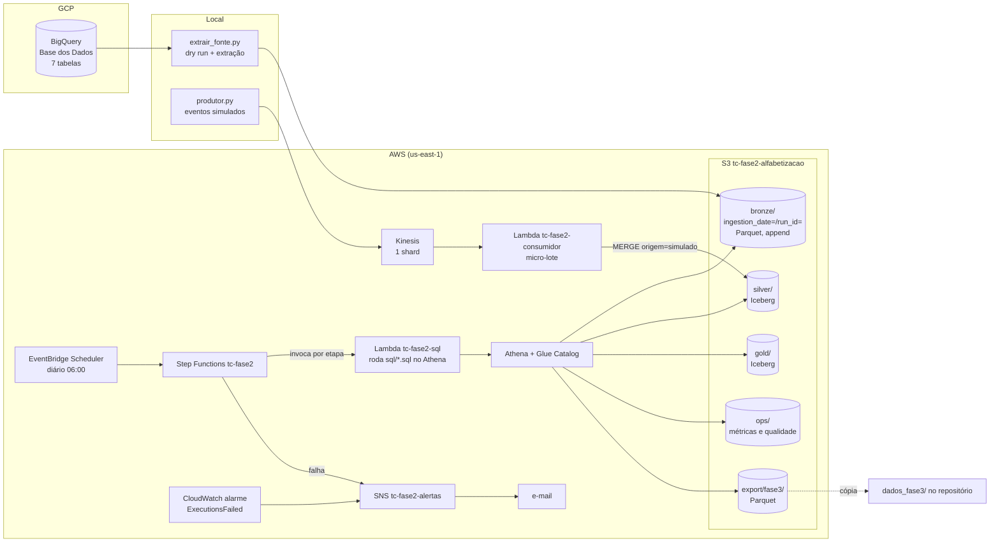

# Pipeline híbrido para análise da alfabetização no Brasil

Tech Challenge da Fase 2 da Pós-Tech AI Scientist (FIAP).

Construímos um pipeline batch e streaming em arquitetura medalhão na AWS, usando o dataset
`br_inep_avaliacao_alfabetizacao` da Base dos Dados. Tudo foi executado de verdade numa conta do AWS Academy Learner
Lab (us-east-1). Os 32 prints em [`evidencias/`](evidencias/README.md) mostram os identificadores das execuções, as
contagens e os e-mails de alerta.

Sumário: [Vídeo executivo](#vídeo-executivo) ·
[1. Contexto](#1-contexto-do-problema) ·
[2. Arquitetura](#2-arquitetura-proposta) ·
[3. Tecnologias](#3-tecnologias-utilizadas) ·
[4. Decisões](#4-decisões-arquiteturais) ·
[5. Monitoramento e FinOps](#5-monitoramento-e-finops) ·
[6. Aplicação em IA](#6-aplicação-em-ia) ·
[7. Limitações](#7-limitações-conhecidas) ·
[Como executar](#como-executar) ·
[Organização das pastas](#organização-das-pastas)

## Integrantes do grupo

| Nome | RM |
| --- | --- |
| Charles Araújo da Silva | RM375662 |
| Rafael Monteiro | RM376321 |

## Vídeo executivo

Apresentação de até 5 minutos para liderança e stakeholders: problema, arquitetura, valor do pipeline e uso em IA.

**Link:** *(cole aqui o link do vídeo)*

## 1. Contexto do problema

O Compromisso Nacional Criança Alfabetizada tem como objetivo que toda criança esteja alfabetizada ao fim do 2º ano
do ensino fundamental. O INEP definiu o corte em 743 pontos na escala do Saeb, e o Indicador Criança Alfabetizada é o
percentual de alunos que ficam acima desse corte.

O dataset tem seis entidades (alunos, município, UF e as metas de Brasil, UF e município) e mais um `dicionario` de
códigos. Integramos todas para responder, com um número em que dê para confiar, três perguntas: qual é a taxa de
alfabetização por município, por UF e no Brasil; quem atingiu a meta do ano; e como o indicador está evoluindo. O
pipeline também gera a base de features que vamos usar no modelo preditivo da Fase 3.

Tomamos o cuidado de nunca misturar duas leituras de meta. A meta pactuada vem da própria fonte, com uma trajetória
anual de 2024 a 2030; para a rede pública, a de 2030 é 80%, e toda distância até a meta é medida contra ela. Já a
universalização (100%) é a aspiração do programa e aparece só numa coluna própria, `meta_aspiracional`. A projeção
para 2030 é um cenário linear (`cenario_linear_2030`, no ritmo médio desde o primeiro ano e limitado a 0–100%), e não
uma previsão.

Principais resultados (Gold, rede pública):

| | 2023 | 2024 | 2025 |
| --- | --- | --- | --- |
| Brasil, taxa oficial | 55,9% | 59,2% | 66,0% |
| Meta do ano (pactuada) | sem meta | 59,9% (não atingiu) | 64,0% (atingiu) |

Em 2024, 2.788 municípios atingiram a meta (52%), 2.444 não atingiram (46%) e 120 não tinham meta (2%).

Para saber se os municípios melhoraram de 2023 para 2024, usamos o teste de Wilcoxon pareado sobre a taxa oficial dos
dois anos (n = 4.761). A mediana da variação foi de +2,43 p.p., 57,7% dos municípios melhoraram e p ≈ 6·10⁻³³. O
efeito, porém, é pequeno (r = 0,17): a melhora é ampla, mas modesta, e cerca de 42% dos municípios pioraram ou ficaram
iguais. Considerando só os municípios com n efetivo ≥ 30 nos dois anos, a mediana sobe para +2,72 p.p. e r = 0,21. O
cálculo está em [`06_analise/analise.py`](06_analise/analise.py), os gráficos em
[`06_analise/graficos/`](06_analise/graficos/) e os números citados no vídeo em
[`06_analise/numeros.json`](06_analise/numeros.json).

## 2. Arquitetura proposta

O diagrama mostra o que foi implementado e executado.



A Step Function ([`03_orquestracao/pipeline.asl.json`](03_orquestracao/pipeline.asl.json)) tem estas etapas:

1. **Preparar:** fixa o `RUN_ID`, que é a extração da Bronze a processar (por padrão, o último manifesto), e o
   `EXEC_ID` da execução.
2. **Bronze:** registra as partições novas no Glue ([`sql/bronze/01_tabelas.sql`](sql/bronze/01_tabelas.sql)).
3. **Qualidade:** monta o staging já com o motivo de quarentena de cada linha
   ([`sql/silver/01_staging.sql`](sql/silver/01_staging.sql)), grava a quarentena e avalia 18 regras, cujos
   resultados ficam em `ops.quality_results` ([`sql/silver/02_qualidade.sql`](sql/silver/02_qualidade.sql)).
4. **Portão:** se alguma regra bloqueante reprovou, a consulta falha de propósito e cita as regras na mensagem
   ([`sql/silver/03_portao.sql`](sql/silver/03_portao.sql)). Nesse caso nada é publicado.
5. **PublicarSilver:** faz MERGE por `(ano, id_aluno)` só das linhas sem motivo de quarentena
   ([`sql/silver/04_publicar.sql`](sql/silver/04_publicar.sql)).
6. **Gold:** monta o modelo estrela e as tabelas analíticas ([`sql/gold/01_gold.sql`](sql/gold/01_gold.sql)), mede
   o match rate dos joins da própria Gold (3 regras bloqueantes) e passa outra vez pelo portão. Se reprovar, o export
   para a Fase 3 não acontece e o alerta é enviado.
7. **ExportarFase3:** grava o dataset analítico em Parquet ([`sql/gold/02_exportar.sql`](sql/gold/02_exportar.sql)).
8. **ManutencaoIceberg:** roda OPTIMIZE e VACUUM ([`sql/ops/manutencao_iceberg.sql`](sql/ops/manutencao_iceberg.sql)).
9. **RegistrarSucesso**; em qualquer falha, o caminho é **RegistrarFalha → NotificarFalha (SNS) → Falhou**.

As camadas ficaram assim:

| Camada | Onde | Conteúdo | Política de escrita |
| --- | --- | --- | --- |
| Bronze | `s3://…/bronze/<tabela>/ingestion_date=AAAA-MM-DD/run_id=<id>/` + `bronze/_manifestos/` | As 7 tabelas exatamente como vieram do BigQuery, em Parquet/snappy | Só append. Cada extração grava num `run_id` novo e nenhuma execução sobrescreve outra. Hoje convivem 2 extrações reais e 3 adulteradas (print 04) |
| Silver | `tc_fase2_silver` (Iceberg) | `alunos` (com `avaliado`, `alfabetizado` nulo para quem não foi avaliado e `origem`), `resultado_oficial` (município + UF), `meta` (Brasil + UF + município, com a rede convertida de texto para código), `dicionario` e `quarentena` | `alunos` recebe MERGE pela chave, então reprocessar o mesmo `run_id` não duplica nada (print 11). As tabelas pequenas são regravadas inteiras a cada execução |
| Gold | `tc_fase2_gold` (Iceberg) | `dim_localidade`, `dim_rede`, `fato_resultado` (taxa ponderada, IC 95%, taxa oficial e convergência), `fato_meta`, `evolucao`, `ml_features` e `ml_features_meta` | Reconstruída a cada execução (DROP + CTAS), só com `origem = 'oficial'` |
| Ops | `tc_fase2_ops` | `quality_results`, `run_metrics`, `etapa_metrics` e `streaming_metrics` | Só INSERT, acumulando as execuções |

Cada entidade da fonte tem um papel:

| Entidade | Onde é usada |
| --- | --- |
| `alunos` | Taxa ponderada recalculada (`fato_resultado`) e features |
| `municipio` e `uf` | Taxa oficial para a validação cruzada (`fato_resultado`) e features (`ml_features`) |
| `meta_alfabetizacao_brasil`, `meta_alfabetizacao_uf` e `meta_alfabetizacao_municipio` | Meta do ano e meta pactuada para 2030 em `fato_meta`, `evolucao`, `ml_features` e `ml_features_meta`. A meta do Brasil também traz a taxa oficial nacional |
| `dicionario` | Valida e descreve os códigos de `rede` (regra bloqueante `rede_desconhecida` e `dim_rede`) |

### Qualidade de dados

Resultado da execução real `fe67d8ee20bd`, de 26/10/2026 (print 06):

| Regra | Tipo | Medido | Critério |
| --- | --- | --- | --- |
| `volume_minimo` (alunos) | bloqueante | 3.867.999 | ≥ 1.000.000 |
| `chave_duplicada` em `(ano, id_aluno)` | bloqueante | 0 | = 0 |
| `rede_desconhecida` (código fora do `dicionario`) | bloqueante | 0 | = 0 |
| `avaliado_sem_peso` (valor ausente que distorce a média) | bloqueante | 0 | = 0 |
| `pct_quarentena` em alunos, resultado e meta | bloqueante | 0% | ≤ 0,1% (alunos), = 0 (demais) |
| `match_aluno_uf` | bloqueante | 100% | = 100% |
| `match_aluno_resultado_municipio` | bloqueante | 99,92% | ≥ 99% |
| `match_aluno_meta_municipio` | bloqueante | 97,63% | ≥ 95% |
| `colunas_vazias` em alunos, resultado e meta (contrato de schema) | bloqueante | 0 | = 0 |
| `idade_extracao` (dias desde a extração processada) | bloqueante | 5 | ≤ 35 |
| Gold: `match_resultado_oficial_municipio` | bloqueante | 99,88% | ≥ 99% |
| Gold: `match_ml_alvo_ano_seguinte` | bloqueante | 99,05% | ≥ 98% |
| Gold: `match_ml_meta_ano_seguinte` | bloqueante | 96,48% | ≥ 95% |
| `rede_privada_fora_do_recorte`, `pct_nao_avaliados`, `meta_municipio_sem_resultado`, `match_meta_uf_resultado_uf` | informativas | 25 · 13,27% · 120 · 90,74% | registro |

Os limiares de match foram escolhidos depois de medir os joins na exploração:

- Aluno → UF precisa casar 100%, porque o código da UF sai do próprio `id_municipio`.
- Aluno → resultado municipal fica em 99%. A tabela oficial cobre quase todo município que tem aluno, e os 0,08% sem
  par são um ruído que já conhecíamos.
- Aluno → meta municipal fica em 95%, porque nem todo município tem meta pactuada. O medido foi 97,6%.
- Na Gold valem os mesmos critérios para os joins que montam `fato_resultado` e `ml_features`. O join com o resultado
  de t+1 é INNER, então o município sem rede municipal avaliada em t+1 sai da base; a regra em 98% garante que isso
  continue sendo exceção (46 de 4.825).
- `match_meta_uf_resultado_uf` (90,74%) é informativa porque a causa da falta é conhecida: 5 dos 54 pares UF × ano
  até 2024. AC, DF e RR em 2023 e RR em 2024 não têm taxa nem na tabela `uf` nem na meta, e o DF de 2024 tem taxa na
  meta (59,13%), mas não aparece na tabela `uf`. É uma lacuna da própria fonte.

Quando um match cai abaixo do limiar, o mais provável é uma chave quebrada (tipo diferente, zero à esquerda), e não
uma ausência real.

### Falhas demonstradas

O script [`02_ingestao/injetar_falha.py`](02_ingestao/injetar_falha.py) copia uma extração real para um `run_id`
adulterado. Testamos três modos:

- **Grave:** acrescenta 5.000 duplicados, 3 redes inválidas e 15 linhas ruins. O portão reprova `chave_duplicada`,
  `rede_desconhecida` e `pct_quarentena`, a Step Function termina vermelha, a Silver fica intacta e o alerta chega por
  e-mail (prints 08 a 10, 20 e 24).
- **Leve:** só as 15 linhas ruins. Elas vão para a quarentena com o registro original e a execução segue normalmente
  (prints 17 e 18).
- **Gold:** `alunos` fica intacto, mas a meta municipal de 2024 chega sem Pernambuco (184 municípios). A Silver passa,
  porque `match_aluno_meta_municipio` mede 2023 e 2024 juntos e fica em 95,84%. Já o join de t+1 da Gold cai para
  92,63%, e o portão da Gold reprova `match_ml_meta_ano_seguinte`. A execução `falha-gold-20261027-1751` termina
  vermelha sem exportar para a Fase 3; o e-mail do SNS chega com a regra que bloqueou e, um minuto depois, chega o do
  alarme do CloudWatch (prints 21, 22, 27 e 29 a 32).

Vale registrar que, nesse último caso, o portão protege o export, mas não a Silver nem a Gold: as duas já tinham sido
gravadas com a meta parcial. A execução real seguinte substitui essas tabelas, porque as pequenas são regravadas
inteiras, e foi o que fizemos logo depois (`real-20261027-1756`, verde).

## 3. Tecnologias utilizadas

O que está implementado e foi executado:

| Ferramenta | Papel | Por quê |
| --- | --- | --- |
| BigQuery (Base dos Dados) | Fonte das 7 tabelas | Ver [forma de acesso](#forma-de-acesso-à-fonte) |
| Python 3.12, `google-cloud-bigquery`, `pyarrow` | Extração com dry run, manifesto e Parquet | Mede os bytes antes de ler e grava direto no S3 |
| Amazon S3 | Data lake (Bronze, Silver, Gold, ops e export) | Armazenamento barato e separado do processamento |
| AWS Glue Data Catalog | Catálogo das tabelas | Já integrado ao Athena e sem servidor |
| Amazon Athena (SQL) + Apache Iceberg | Silver e Gold | MERGE, DELETE, time travel e OPTIMIZE/VACUUM sem cluster. O volume (~270 MB) não justifica Spark |
| AWS Lambda | Executa os `.sql` do repositório e consome o Kinesis | Usa o mesmo runner ([`apoio/athena.py`](apoio/athena.py)) que rodamos localmente |
| AWS Step Functions | Orquestração com dependência entre etapas, retentativa e Catch | A falha fica visível e auditável por etapa |
| Amazon EventBridge Scheduler | Execução diária às 06:00 (America/Sao_Paulo) | Agendamento gerenciado |
| Amazon SNS | Alerta por e-mail | Notificação real quando algo falha |
| Amazon CloudWatch | Alarme `ExecutionsFailed ≥ 1` e métricas do Athena | Segunda linha de aviso, além do Catch |
| Amazon Kinesis Data Streams | Mensageria do streaming simulado | Entrega pelo menos uma vez e em lotes, como em produção |
| DuckDB + Jupyter | Exploração ([`01_exploracao/exploracao_dos_dados.ipynb`](01_exploracao/exploracao_dos_dados.ipynb)) | SQL local sobre a Bronze, sem custo de nuvem |
| pandas + matplotlib | Teste estatístico e gráficos ([`06_analise/analise.py`](06_analise/analise.py)) | Lê só o export da Fase 3, sem precisar da AWS |

Ficou para uma próxima etapa (não implementado):

- Infraestrutura como código com estado. Hoje temos scripts de CLI que podem ser rodados várias vezes
  ([`03_orquestracao/implantar.sh`](03_orquestracao/implantar.sh) e [`04_streaming/implantar.sh`](04_streaming/implantar.sh)),
  mas sem estado nem plano.
- Extração orquestrada na nuvem (ver limitações).
- Alarme para quando o pipeline deixa de rodar.

## 4. Decisões arquiteturais

### Forma de acesso à fonte

Escolhemos ler as sete tabelas pelo BigQuery. A tabela `alunos` (3,9 milhões de linhas) só tem download direto no
plano pago, e o `dicionario` só existe no BigQuery. O download gratuito das outras cinco é gerado na hora do clique,
sem URL estável, o que obrigaria a um passo manual, e a ideia era que o pipeline rodasse seguindo só o README. Com o
BigQuery, um único mecanismo de ingestão atende as sete tabelas, e o dry run mede os bytes antes de cada leitura, o
que nos deu números reais para o FinOps.

Sobre o custo, medido no histórico de jobs do BigQuery (print 01):

- A primeira extração processou 268,5 MB em `alunos` e quase nada nas outras seis. Foram faturados 317 MiB, porque o
  BigQuery cobra no mínimo 10 MB por consulta e as seis tabelas pequenas pagam esse piso. Isso dá uns 0,03% da
  franquia gratuita de 1 TiB por mês.
- A segunda extração no mesmo dia faturou 0 bytes: o BigQuery reaproveita o resultado por 24 h quando a tabela não
  mudou, então repetir a extração depois de uma falha não custa nada.
- O dado sai do GCP e entra no S3, e a entrada na AWS é gratuita. O volume é pequeno (268 MB lidos viram 71,5 MB em
  Parquet/snappy); mesmo cobrado como egress de internet do GCP (US$ 0,12/GB), o teto fica abaixo de US$ 0,04 por
  extração.
- O multi-cloud tem seu preço, mesmo sem duplicar armazenamento no GCP (o dado mora na Base dos Dados): são duas contas
  de billing (sandbox gratuito do GCP e Learner Lab da AWS), dois modelos de identidade (credencial ADC no GCP e
  `LabRole` na AWS) e a necessidade de conhecer o básico de BigQuery. Aceitamos isso porque o GCP só aparece como
  fonte, na etapa de extração; todo o processamento, armazenamento e consumo ficam na AWS.

Quando a fonte for atualizada, cada extração continua sendo um snapshot completo num `run_id` novo da Bronze, sem
sobrescrever o anterior. Uma revisão retroativa do INEP fica registrada e pode ser comparada entre dois `run_id`, e um
ano novo publicado entra na próxima extração sem mudar código.

Mudanças de schema têm efeitos diferentes. A extração usa `SELECT *` e a Bronze lê o Parquet pelo nome da coluna; um
tipo incompatível faz a leitura falhar na etapa `Qualidade`. Uma coluna removida ou renomeada, por outro lado, não
gera erro: ela simplesmente vira nula. Por isso criamos a regra bloqueante `colunas_vazias`, que reprova a extração em
que alguma coluna usada pelo pipeline vem inteira nula, e o alerta sai antes de publicar. Colunas novas são ignoradas
até serem incorporadas.

Preferimos snapshot completo a carga incremental (`WHERE ano > último`) porque o volume é pequeno, cabe na franquia e o
snapshot capta revisões retroativas, que o incremental perderia. Como a fonte muda uma vez por ano, extrair uma vez
por mês é suficiente. A extração roda fora da orquestração (ver limitações), e a regra bloqueante `idade_extracao`
reprova a Bronze com mais de 35 dias: se a extração parar, o pipeline diário fica vermelho e avisa, em vez de
reprocessar um snapshot velho em silêncio.

### Batch × streaming

| | Batch (Step Function diária) | Streaming (Kinesis → Lambda) |
| --- | --- | --- |
| Gatilho | Scheduler às 06:00 ou manual | Cada evento que chega ao stream |
| Processamento | A extração inteira (3,9 mi linhas) em ~5 min | Micro-lote de até 500 eventos ou 20 s |
| Latência medida | Até ~24 h entre a extração e a Gold (execução diária). Da fonte até a extração: manual, mensal, com alerta acima de 35 dias | p50 de 27 s e p95 de 40 s do envio até a gravação na Silver na 1ª rodada; 57 s e 71 s na 2ª (print 25) |
| Garantia | Reprocessável e idempotente: o mesmo `run_id` gera o mesmo resultado | O Kinesis entrega pelo menos uma vez |
| Duplicados | Regra bloqueante `chave_duplicada` | O último evento de cada `(ano, id_aluno)` vence no lote, e o MERGE pela chave transforma o reenvio entre lotes em UPDATE |
| Inválidos | Quarentena e regras bloqueantes | Quarentena com o evento original (`tabela = 'alunos_stream'`) |

Na primeira rodada do streaming, o [`04_streaming/produtor.py`](04_streaming/produtor.py) enviou 600 eventos: 536
alunos, 59 reenvios e 5 inválidos. Dos reenvios, 50 caíram no mesmo lote e 11 em lotes diferentes. A Silver ficou com
534 linhas e 534 ids, sem nenhuma duplicata, e os 5 inválidos foram para a quarentena. Na segunda rodada (26/10), já
com retentativa, alarmes e a `rede` validada pelo `dicionario`, reenviamos os mesmos 600 eventos: a deduplicação foi a
mesma, a Silver continuou com 534 linhas e 534 ids e mais 5 inválidos foram para a quarentena (prints 25 e 28). A
latência subiu para p50 de 57 s porque a Lambda só começou a ler o shard cerca de 1 min depois do primeiro evento,
logo após reconfigurarmos o gatilho; o processamento do lote maior em si levou 15 s.

Outros pontos do streaming:

- **Falha no consumidor:** o gatilho do Kinesis tenta o lote até 2 vezes, partindo-o ao meio para isolar o evento ruim
  (`bisect`). Esgotadas as tentativas, os metadados do lote vão para o SNS `tc-fase2-alertas` e o shard não trava. Os
  alarmes `tc-fase2-streaming-erros` (erro de invocação) e `tc-fase2-streaming-atraso` (`IteratorAge` acima de 5 min,
  ou seja, atraso de leitura) avisam no mesmo tópico ([`04_streaming/implantar.sh`](04_streaming/implantar.sh)).
- **Validação:** o código de `rede` é conferido contra o `dicionario` da Silver, o mesmo que o batch usa, lido uma vez
  por container da Lambda.
- **Latência:** é medida de fato. O produtor grava `enviado_em` no evento e o consumidor calcula a diferença depois que
  o MERGE confirma. O piso de ~20 s vem do MERGE do Athena; é quase tempo real, não tempo real.
- **Separação do dado simulado:** os eventos entram com `origem = 'simulado'`, o MERGE só atualiza linhas que já são
  simuladas (nunca sobrescreve dado oficial) e a Gold filtra `origem = 'oficial'`. Assim, o simulado não contamina
  nenhum indicador.

### Outras decisões

- **Data lake (S3 + Iceberg) em vez de data warehouse:** o volume é pequeno e o acesso é por lote. O Iceberg nos dá o
  que precisaríamos de um warehouse (MERGE, transação, time travel) pagando só armazenamento e bytes lidos, sem cluster
  ligado nem custo fixo.
- **Athena SQL em vez de Spark (custo × performance):** uma execução completa custa centavos e leva ~5 min (5 min 16 s
  na execução verde, print 19). Um cluster Spark gastaria minutos só para subir, com custo fixo, para processar uns
  270 MB.
- **Taxa recalculada a partir dos microdados, com validação cruzada:** a taxa é Σ peso·alfabetizado / Σ peso, só sobre
  os alunos avaliados, com IC 95% de Wilson e n efetivo de Kish. No Brasil em 2024, o calculado dá 59,20% (IC
  59,13–59,27) contra 59,2% oficial, e em 99,97% dos 12.049 pares município × rede de 2024 o oficial cai dentro do IC
  (print 12).
- **Nulo não é zero, e "sem meta" não é "não atingiu":** `alfabetizado` fica nulo para quem não foi avaliado (13,3% dos
  registros). `fato_meta` separa `atingiu`, `nao_atingiu`, `sem_meta` e `sem_resultado`; como não existe meta em 2023,
  esses casos aparecem como `sem_meta`. Município × rede sem nenhum aluno avaliado (18 casos) tem taxa calculada nula e
  `convergencia = 'sem_calculo'`, nunca `diverge`.
- **Recorte:** rede pública (2 estadual, 3 municipal; 5 é o total da rede pública) e 2º ano. A rede privada (25 alunos
  de uma escola) fica fora e é registrada numa regra informativa.

## 5. Monitoramento e FinOps

### Monitoramento

| O que | Onde fica | Persistência |
| --- | --- | --- |
| Status e duração de cada execução | `tc_fase2_ops.run_metrics` (print 21) | Um INSERT por execução, acumulando |
| Duração, status, consultas, bytes escaneados, linhas de entrada e linhas escritas por etapa | `tc_fase2_ops.etapa_metrics` (print 27) | Um INSERT por etapa, inclusive quando a etapa falha |
| Resultado de cada regra de qualidade | `tc_fase2_ops.quality_results` | Um INSERT por execução |
| Volume e latência do streaming (p50, p95 e máxima por lote) | `tc_fase2_ops.streaming_metrics` (print 25) | Um INSERT por lote |
| Falhas de ingestão e de processamento | Catch da Step Function → `run_metrics` + SNS | — |
| Alerta | E-mail do SNS `tc-fase2-alertas` (prints 24 e 31) e alarme do CloudWatch `ExecutionsFailed ≥ 1`, que também manda e-mail (prints 22 e 32) | — |
| Alerta do streaming | Alarmes `tc-fase2-streaming-erros` e `tc-fase2-streaming-atraso` (`IteratorAge`) e lote esgotado → mesmo SNS (print 28) | — |

Um exemplo de execução real, tirado de `etapa_metrics`: a etapa `Qualidade` fez 17 consultas, leu 500 MB e recebeu
3.867.999 linhas em 55 s; `PublicarSilver` escreveu 3.937.909 linhas em 60 s; e a `Gold` gerou 54.909 linhas em 57 s.
Essa execução levou 3 min 52 s no total, mas foi anterior às etapas de exportação e manutenção. A execução verde de
27/10 (`real-20261027-1756`, print 19), já com todas as etapas, levou 5 min 16 s.

**Em produção, quem descobre que o pipeline quebrou, e em quanto tempo?** Quem assina o tópico do SNS recebe o e-mail
cerca de 1 minuto depois de a etapa falhar. Medimos isso na falha induzida: a execução `falha-grave-20261022-1141`
falhou no portão e o e-mail chegou às 11:42. O alarme do CloudWatch é a segunda linha de aviso e chega em até 5 min,
mesmo que o próprio Catch falhe. Uma extração parada é pega pela regra `idade_extracao`: com mais de 35 dias, a
execução diária reprova e avisa. No streaming, erro do consumidor ou atraso acima de 5 min disparam alarme no mesmo
tópico. O ponto cego, que descrevemos nas limitações, é o pipeline simplesmente não rodar (Scheduler parado): hoje
isso não gera alerta.

### FinOps

O que fizemos para manter o custo baixo:

- **Armazenamento:** Parquet/snappy em todas as camadas (`alunos` cai de 268 MB lidos no BigQuery para 70,7 MB),
  Silver particionada por `ano` e `athena-results/` expirando em 7 dias por uma regra de ciclo de vida do S3.
- **Consultas:** workgroup `tc-fase2` com limite de 1 GiB por consulta e métricas no CloudWatch; filtro por `run_id`
  na Bronze, para ler só a extração da vez; e a Gold lê a Silver, não os dados brutos.
- **Manutenção do Iceberg:** cada MERGE guarda os arquivos antigos para o time travel, e a Silver chegou a 270,8 MB,
  cerca de quatro vezes uma extração. OPTIMIZE (bin pack) e VACUUM levaram para 71,0 MB (medido em 22/10):
  `silver.alunos` passou de 10 para 3 arquivos e de 6 para 1 snapshot, com as mesmas linhas. Isso virou uma etapa do
  pipeline, com retenção de 1 dia. Logo depois da execução de 27/10, `silver.alunos` tinha 3 arquivos (72,5 MB) e os 7
  snapshots das últimas 24 h, que o VACUUM do dia seguinte expira (print 26).
- **Rastreio de custo:** os scripts marcam com a tag `projeto=tc-fase2` as Lambdas, a Step Function, o SNS, o Kinesis,
  os alarmes e o workgroup do Athena, para filtrar o custo do projeto no Cost Explorer.
- **Computação:** Lambda de 256 MB, só durante as etapas, sem cluster nem servidor ligado. O Kinesis só existe durante
  a demonstração ([`04_streaming/remover.sh`](04_streaming/remover.sh) apaga o stream e os dois alarmes do streaming).

**Estimativa de custo.** Rodamos no AWS Academy Learner Lab (sandbox com crédito) e no sandbox gratuito do GCP. A
tabela projeta o mesmo desenho em produção, com uma extração por mês e o pipeline uma vez por dia. As quantidades foram
medidas em 22/10/2026 com [`05_finops/medir_custos.py`](05_finops/medir_custos.py), que gera
[`05_finops/medicao.md`](05_finops/medicao.md), e os preços são os da tabela pública (us-east-1 e BigQuery on-demand),
sem descontar os níveis gratuitos da AWS.

| Serviço | Unidade | Quantidade medida | Preço unitário | Custo mensal projetado |
| --- | --- | --- | --- | --- |
| BigQuery (on-demand) | TiB faturado | 317 MiB por extração (print 01) | US$ 6,25/TiB, 1 TiB/mês grátis | US$ 0,00 (US$ 0,002 sem a franquia) |
| Egress GCP → AWS | GB | ≤ 0,27 GB por extração (teto) | ~US$ 0,12/GB | ≤ US$ 0,04 |
| S3 Standard | GB-mês | 0,82 GB hoje (Bronze com 273 MB e 4 extrações; a Silver varia com os snapshots retidos) | US$ 0,023/GB-mês | US$ 0,02 |
| Athena | TB cobrado | 1,68 GB por execução (90 consultas, 851 MB lidos; o mínimo de 10 MB por consulta quase dobra a conta) | US$ 5/TB | US$ 0,24 |
| Lambda | GB-s | 317 s × 0,25 GB = 79 GB-s por execução | US$ 0,0000166667/GB-s | US$ 0,04 |
| Step Functions (Standard) | transição | ~16 por execução | US$ 0,025/1.000 | US$ 0,01 |
| CloudWatch | alarme | 1 | US$ 0,10/alarme-mês | US$ 0,10 |
| SNS (e-mail), EventBridge Scheduler, Glue Catalog | notificação, invocação, objeto | < 100 por mês | dentro do nível gratuito | US$ 0,00 |
| **Total (batch)** | | | | **≈ US$ 0,45/mês** |
| Kinesis (se ficasse ligado 24/7) | shard-hora | 1 shard × 730 h | US$ 0,015/shard-h | US$ 10,95 |

O item mais caro seria o Kinesis parado, e é por isso que ele só sobe durante a demonstração; em produção, com eventos
raros, Kinesis on-demand ou SQS sairiam mais baratos. No batch, o maior item é o Athena, e metade dele é o piso de
10 MB por consulta, então juntar consultas pequenas seria a próxima otimização. Reprocessar todo dia uma Bronze que
muda uma vez por ano é um desperdício consciente: custa centavos e deixa o agendamento demonstrável. Em produção, o
gatilho seria a chegada de um manifesto novo.

## 6. Aplicação em IA

**Dataset guardado para a Fase 3.** A Gold é exportada em Parquet para
`s3://<bucket>/export/fase3/run_id=<id>/exec_id=<id>/`, um prefixo sem regra de expiração (print 16). Como a conta do
Learner Lab é temporária, guardamos uma cópia em [`dados_fase3/`](dados_fase3/) (1,5 MB), com um arquivo por tabela.
Os arquivos vêm da execução `run_id=a3e3036c5911`, `exec_id=fe67d8ee20bd` e são gerados de novo por
[`06_analise/exportar_fase3.sh`](06_analise/exportar_fase3.sh).

| Arquivo | Linhas | Para quê |
| --- | --- | --- |
| `ml_features.parquet` | 4.779 municípios | Treino do modelo de regressão (alvo: taxa de t+1) |
| `ml_features_meta.parquet` | 4.779 municípios | Treino do modelo de classificação (alvo: atingiu a meta de t+1) |
| `fato_resultado.parquet` | 22.971 | Taxas, IC e convergência por nível × ano × rede |
| `fato_meta.parquet` | 10.788 | Meta contra resultado |
| `evolucao.parquet` | 10.788 | Variação ano a ano |
| `dim_localidade.parquet`, `dim_rede.parquet` | 5.576 e 7 | Dimensões |

Para ler: `pd.read_parquet("dados_fase3/ml_features.parquet")`.

As duas tabelas de treino (`ml_features` e `ml_features_meta`) são da rede municipal. As features são do ano t
(2023): participação, proficiência média, taxa calculada, largura do IC, nível de alfabetização da meta, UF, região e
meta pactuada. As colunas `proporcao_aluno_nivel_*` vêm vazias em 2023, porque a fonte só publica a distribuição por
nível a partir de 2024; elas passam a servir quando existir o par 2024→2025. Cada tabela tem um único alvo do ano t+1
(2024): `alvo_taxa_ano_seguinte` em `ml_features` (regressão) e `alvo_atingiu_meta_ano_seguinte` em `ml_features_meta`
(classificação).

Cuidamos para não haver vazamento de alvo. Nenhuma feature é derivada do resultado de t+1. Os dois alvos derivam um do
outro (atingiu = taxa de t+1 ≥ meta de t+1), por isso ficam em tabelas separadas, e nenhuma das duas carrega o alvo da
outra. `meta_ano_seguinte` é conhecida antes do resultado (é pactuada) e pode ser usada como feature. O alvo de
classificação fica nulo quando não há meta ou resultado (168 municípios), para que "sem meta" não vire "não atingiu";
essas linhas saem do treino.

Com essa base, dá para priorizar os municípios com risco de não atingir a meta (política pública baseada em dados),
estudar a desigualdade entre regiões e redes e, quando houver mais edições, medir o efeito de ações.

## 7. Limitações conhecidas

- **Em 2023, o Brasil calculado diverge do oficial, e a causa é a cobertura dos microdados.** A taxa recalculada para
  o Brasil é 57,46%, contra 55,9% publicado (1,56 p.p.), com o oficial fora do IC. Os microdados de 2023 trazem só 23
  UFs: faltam SP, AC, DF e RR, e o número oficial inclui SP, cuja taxa em 2023 (51,91%) fica bem abaixo da média. Nas
  23 UFs presentes, 21 batem com o oficial da UF e as outras 2 diferem no máximo 0,31 p.p., então o cálculo está certo
  e o que muda é o conjunto de alunos. Ponderando as taxas oficiais das UFs pelo número de alunos de 2024, a média das
  23 UFs dos microdados dá ~57,6% (o calculado é 57,46%) e, com SP, cai para ~56,4%; a ausência de SP explica a maior
  parte da diferença. Nos municípios, 372 pares município × rede de 2023 divergem mais de 0,05 p.p. (183 em 2024),
  quase todos com o oficial dentro do IC (5 fora em 2023 e 3 em 2024). A divergência fica exposta em
  `fato_resultado.convergencia`. Em 2024, só RR falta nos microdados, e o Brasil bate (59,20% contra 59,2%).
- **Só duas edições de microdados** (2023 e 2024), então `ml_features` tem um único par t→t+1. 2025 só existe no
  agregado (Brasil e UF), e a distribuição por nível (`proporcao_aluno_nivel_*`) só aparece na fonte a partir de 2024.
- **A extração roda fora da orquestração.** O `extrair_fonte.py` roda localmente com a credencial do GCP; levar essa
  chave para a AWS seria mover um segredo entre nuvens sem necessidade nesta fase. A Step Function processa o último
  manifesto disponível, e a regra `idade_extracao` reprova se ele tiver mais de 35 dias.
- **Restrições do Learner Lab:** as credenciais valem 4 h por sessão, só existe a `LabRole` e a região é us-east-1.
  Não testamos se o Scheduler e o alarme disparam com o lab parado, e não há alerta para "o pipeline não rodou" (seria
  um alarme de ausência de `ExecutionsSucceeded` em 24 h, que fica para a próxima etapa).
- **O streaming é simulado:** os eventos são gerados pelo produtor (alunos `SIM-*`, ano 2025), não vêm do INEP, e a
  latência tem um piso de ~20 s por causa do MERGE do Athena.
- **A etapa Qualidade lê ~500 MB por execução**, porque várias regras releem o staging. Materializar o staging reduziria
  esse custo.
- **Não temos infraestrutura como código com estado nem testes automatizados.**
- **Manutenção do Iceberg:** para mostrar o efeito do VACUUM no mesmo dia, rodamos uma vez com retenção de 60 s. A
  configuração permanente é de 1 dia.

## Como executar

Pré-requisitos:

- Python 3.12;
- AWS CLI com credenciais (no Learner Lab: Start Lab → AWS Details → AWS CLI → `~/.aws/credentials`);
- um projeto no GCP com Application Default Credentials (`gcloud auth application-default login`).

Todos os comandos rodam a partir da raiz do repositório.

```bash
# 1. Ambiente
python3.12 -m venv .venv && .venv/bin/pip install -r requirements.txt
cp .env.example .env        # preencher GCP_PROJECT, S3_BUCKET e ALERTA_EMAIL
set -a; . ./.env; set +a
aws s3 mb "s3://$S3_BUCKET"

# 2. Bronze: extração do BigQuery (o dry run mede os bytes antes)
.venv/bin/python 02_ingestao/extrair_fonte.py --dry-run
.venv/bin/python 02_ingestao/extrair_fonte.py --destino "s3://$S3_BUCKET/bronze"

# 3. Orquestração: Lambda, Step Function, SNS, Scheduler, alarme e ciclo de vida do S3
bash 03_orquestracao/implantar.sh        # confirme a assinatura no e-mail que chegar
SM=arn:aws:states:$AWS_REGION:$(aws sts get-caller-identity --query Account --output text):stateMachine:tc-fase2
aws stepfunctions start-execution --state-machine-arn "$SM" --input '{}'

# 4. Falha induzida (o portão bloqueia e o e-mail chega)
.venv/bin/python 02_ingestao/injetar_falha.py --base <run_id real> --modo grave   # ou leve, ou gold; imprime o run_id adulterado
aws stepfunctions start-execution --state-machine-arn "$SM" --input '{"RUN_ID":"<run_id adulterado>"}'

# 5. Streaming (o shard é cobrado por hora: remova depois)
bash 04_streaming/implantar.sh
.venv/bin/python 04_streaming/produtor.py --eventos 600 --por-segundo 20
bash 04_streaming/remover.sh

# 6. Dataset da Fase 3, FinOps e análise
bash 06_analise/exportar_fase3.sh
.venv/bin/python 05_finops/medir_custos.py > 05_finops/medicao.md
.venv/bin/python 06_analise/analise.py   # gráficos e numeros.json em 06_analise/
```

Para consultar qualquer tabela: `.venv/bin/python apoio/athena.py -q "SELECT ... FROM tc_fase2_gold.fato_meta"`.

O notebook de exploração lê uma Bronze local. Para usá-lo, rode `extrair_fonte.py` sem `--destino` (ele grava em
`data/bronze`) e abra `01_exploracao/exploracao_dos_dados.ipynb` com o kernel do `.venv`. A análise
(`06_analise/analise.py`) só precisa de `dados_fase3/` e roda sem AWS.

Projeto do GCP, bucket, região e e-mail vêm do `.env` (modelo em [`.env.example`](.env.example)). Nenhuma credencial
está no repositório.

## Organização das pastas

| Pasta | Conteúdo |
| --- | --- |
| [`01_exploracao/`](01_exploracao/) | Notebook com os 14 achados da exploração da Bronze, que viraram regras e decisões |
| [`02_ingestao/`](02_ingestao/) | Extração do BigQuery para a Bronze e o script que injeta falhas |
| [`03_orquestracao/`](03_orquestracao/) | Step Function, Lambda que executa os SQL e o script de implantação |
| [`04_streaming/`](04_streaming/) | Produtor de eventos, consumidor (Lambda) e scripts para subir e remover o Kinesis |
| [`05_finops/`](05_finops/) | Script de medição de custos e a medição usada na estimativa |
| [`06_analise/`](06_analise/) | Teste estatístico, gráficos, números do vídeo e export da Fase 3 |
| [`sql/`](sql/) | SQL das camadas `bronze/`, `silver/` e `gold/` e das tabelas de operação (`ops/`) |
| [`apoio/`](apoio/) | `athena.py`, o executor de SQL usado localmente e pelas Lambdas |
| [`evidencias/`](evidencias/README.md) | Os 32 prints da execução, com o que cada um comprova |
| [`dados_fase3/`](dados_fase3/) | Dataset analítico guardado para o modelo da Fase 3 |
